# sm120-vllm-kernels

Kernel and serving optimizations for **unsloth/Qwen3.6-35B-A3B-NVFP4-Fast** on **vLLM v0.32.0** with one
**RTX PRO 6000 Blackwell** (SM120, 188 SMs, 600 W).

The model is a hybrid: 30 Gated DeltaNet (linear attention) layers, 10 full-attention layers
(16 Q / 2 KV heads, head_dim 256, FP8 KV cache) and a 256-expert top-8 MoE in every layer. MoE weights are NVFP4,
and the attention/GDN projections are FP8. MTP-2 speculative decoding is on.

## Results

<picture>
  <source media="(prefers-color-scheme: dark)" srcset="docs/img/prefill-span-dark.svg">
  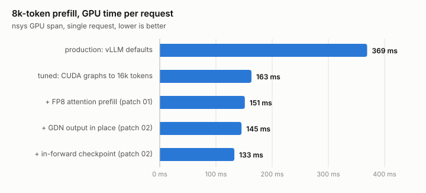
</picture>

8k-token single-request prefill, GPU span from nsys (`results/nsys/`):

| config | ms / request | vs production |
|---|---:|---:|
| production (vLLM defaults) | 369 | |
| tuned (config only) | 163 | −56% |
| optimized (tuned + patches 01, 02) | 133 | −64% |
| next (optimized + patches 03, 04, 05) | 125 | −66% |

`next` is measured against optimized in the same session (137 → 125 ms at 8k, 574 → 551 ms at 32k;
`results/next/SUMMARY.md`). It has not been through the throughput sweep and the agentic replay yet, so the
tables below still compare production, tuned and optimized.

<picture>
  <source media="(prefers-color-scheme: dark)" srcset="docs/img/throughput-dark.svg">
  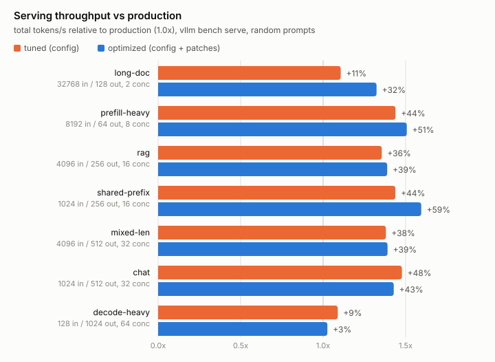
</picture>

Serving throughput, total tok/s (`results/throughput/COMPARISON.md`, one run per cell):

| scenario | in / out / concurrency | production | tuned | optimized |
|---|---|---:|---:|---:|
| long-doc | 32768 / 128 / 2 | 23,357 | +11% | **+32%** |
| prefill-heavy | 8192 / 64 / 8 | 27,038 | +44% | **+51%** |
| rag | 4096 / 256 / 16 | 16,916 | +36% | **+39%** |
| shared-prefix | 4096 shared + 1024 / 256 / 16 | 16,792 | +44% | **+59%** |
| mixed-len | 410–7782 / 51–973 / 32 | 13,213 | +38% | **+39%** |
| chat | 1024 / 512 / 32 | 5,552 | **+48%** | +43% |
| decode-heavy | 128 / 1024 / 64 | 4,385 | **+9%** | +3% |

<picture>
  <source media="(prefers-color-scheme: dark)" srcset="docs/img/ttft-dark.svg">
  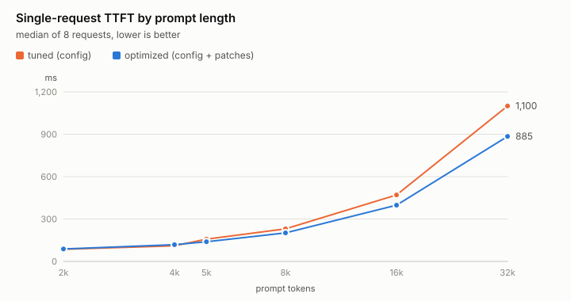
</picture>

Single-request median TTFT (`results/prefill/`): 8k 230 → 202 → 190 ms, 32k 1100 → 885 → 856 ms
(tuned → optimized → next). Decode at c=64 is unchanged by patches 01/02/03/05; the 64-token kernel page of
optimized costs ~4% at c=64, which patch 04 removes (`results/decode_ab/SUMMARY.md`).

### Agentic workloads

Multi-turn tool-calling sessions (list_dir / read_file / grep / write_file / run_tests) were recorded live, then
replayed token for token on every config, so each config prefills and decodes exactly the same tokens
(`bench/agentic_bench.py`, `results/agentic/SUMMARY.md`). There are two sets: short coding sessions
(10-30k tokens) and whole-package reviews that grow each session to ~126k tokens.

<picture>
  <source media="(prefers-color-scheme: dark)" srcset="docs/img/agentic-long-ttft-dark.svg">
  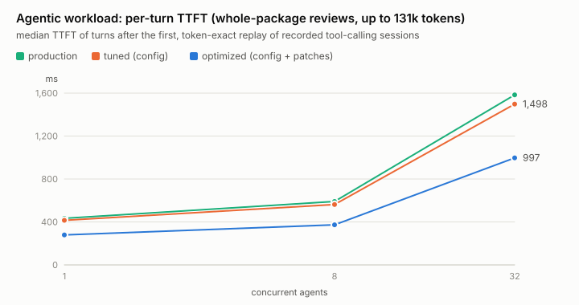
</picture>

<picture>
  <source media="(prefers-color-scheme: dark)" srcset="docs/img/agentic-short-throughput-dark.svg">
  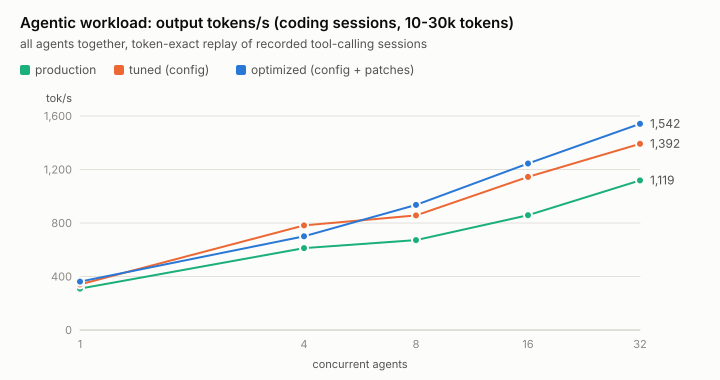
</picture>

| | production | tuned | optimized |
|---|---:|---:|---:|
| long sessions, 1 agent, TTFT p50 / p90 | 433 / 624 ms | 415 / 614 ms | **279 / 373 ms** |
| long sessions, 32 agents, TTFT p50 / p90 | 1584 / 3785 ms | 1498 / 3266 ms | **997 / 1992 ms** |
| long sessions, 32 agents, turns/s | 2.32 | 2.36 | **3.42 (+47%)** |
| short sessions, 32 agents, turns/s | 4.37 | 5.44 | **6.03 (+38%)** |

At long context, per-turn time is dominated by attention over the cached prefix. The config change barely helps
there; FP8 attention (patch 01) is what cuts it by a third.

#### Agentic caching (interim, verification pending)

Each turn's prompt is the previous prompt plus the model's output and a tool result. Attention KV can be reused
token by token, but the GDN recurrent state can only resume where it was saved, and stock vLLM saves it every
2128 tokens. So every turn recomputes the tail since the last boundary: on the long sessions ~4,760 tokens are
prefilled per turn when ~1,740 are new.

<picture>
  <source media="(prefers-color-scheme: dark)" srcset="docs/img/mech-agentic-cache-dark.svg">
  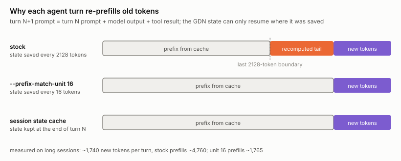
</picture>

Two fixes measured so far, each as an A/B on one server with the same turns (`kernels/cache-granularity`,
`kernels/session-cache`):

<picture>
  <source media="(prefers-color-scheme: dark)" srcset="docs/img/agentic-cache-dark.svg">
  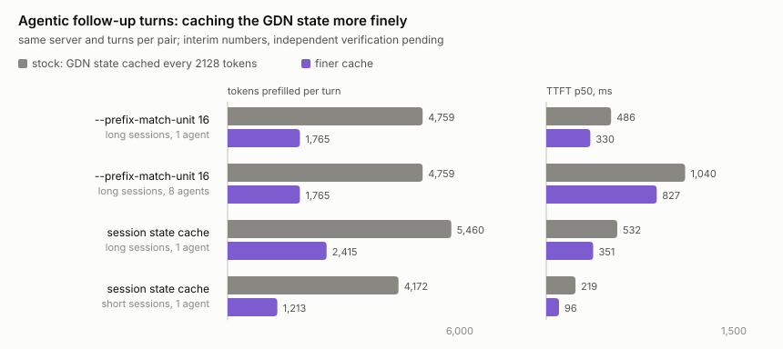
</picture>

- `--prefix-match-unit 16` (a vLLM v0.32 flag, no code change): tokens prefilled per turn 4,759 → 1,765, TTFT p50
  486 → 330 ms with one agent and 1,040 → 827 ms with 8 agents; 8-agent wall time 261 → 171 s. Prefix-cache
  correctness check: TV 0.122, same as stock.
- Session state cache (patch, `VLLM_SESSION_STATE_CACHE=1`): keeps each session's GDN state at the end of its
  turn. Same effect when the client resends the history exactly. When the client rewrites history (e.g. drops
  reasoning) the prefix no longer matches and nothing is saved; in the first such run TTFT p50 even rose
  (203 → 355 ms), which is still being checked.
- CPU offload of idle sessions (`--kv-offloading-backend native`): stores both attention KV and GDN state for this
  hybrid model; the 64-session idle/think benchmark is still running.

These numbers come from the agents' own runs on the production config and are not yet in the tables above.

KV cache capacity drops with the larger CUDA graphs and the 64-token block: 3.98M tokens (production),
3.54M (tuned), 3.37M (optimized), that is 30, 27 and 26 concurrent 131k sessions. At 32 long sessions the
optimized config still wins and the prefix hit rate stays at 94%.

## What changed

**tuned** (no code change): `--max-num-batched-tokens 16384` and CUDA graphs captured up to 16384 tokens
(`scripts/cudagraph_sizes.txt`). With vLLM's default sizes an 8k prefill runs eagerly, and the GPU is busy only
40% of the time.

<picture>
  <source media="(prefers-color-scheme: dark)" srcset="docs/img/mech-cuda-graphs-dark.svg">
  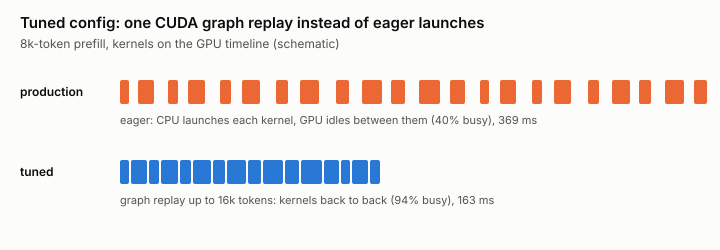
</picture>

**optimized** adds two patches (`patches/vllm-v0.32.0/`), each gated by env flags that default to off:

| flag | patch | effect |
|---|---|---|
| `VLLM_SM120_FP8_PREFILL=1` | 01 | Full-attention prefill (query ≥ 256 tokens) runs FlashInfer's SM120 FP8 FMHA (FP8 Q/K/V on the tensor cores) instead of FA2 with BF16 Q. Spec-decode verify steps keep the BF16 kernel. |
| `VLLM_FI_KERNEL_PAGE64=1` | 01 | 64-token kernel page, so the hybrid block size is a multiple of 64 (needed by the next flag). |
| `VLLM_GDN_INTERNAL_CKPT=1` | 02 | GDN prefill exports the mid-prompt Mamba prefix-cache checkpoint from inside the forward pass (FlashInfer `state_checkpoints`). Without it the scheduler splits every long prompt into two forward passes (8192 → 4256 + 3936). |
| (always, with 02) | 02 | FlashInfer GDN writes its output in place and takes exp(g) from the post-conv kernel, which saves a full-size copy per layer. |

8k span breakdown: 163 (tuned) → 151 (FP8 attention) → 145.5 (GDN in place) → 133 ms (internal checkpoint).

**next** adds three more patches, also env-gated (`CONFIG=next`, after `scripts/build_patched.sh`):

| flag | patch | effect |
|---|---|---|
| `VLLM_SM120_FP8_PREFILL_NOGLUE=1` | 03 | The FP8 FMHA reads K/V straight from vLLM's packed cache through strided TMA descriptors and quantizes Q inside the kernel: 4-5 launches per attention call become 1, output bitwise identical. |
| `VLLM_FI_KERNEL_PAGES=16`, `--block-size 2176` | 04 | Keeps the 64-aligned cache block that the checkpoint needs, but runs attention on 16-token pages. Removes the ~4% decode loss of the 64-token page. |
| `VLLM_GDN_FUSED_CONV=1` | 05 | GDN causal conv1d and post-conv prep in one Triton kernel; the 128 MB conv output never goes to HBM (377 → 190 µs per layer at 8k). |

<picture>
  <source media="(prefers-color-scheme: dark)" srcset="docs/img/mech-fp8-attention-dark.svg">
  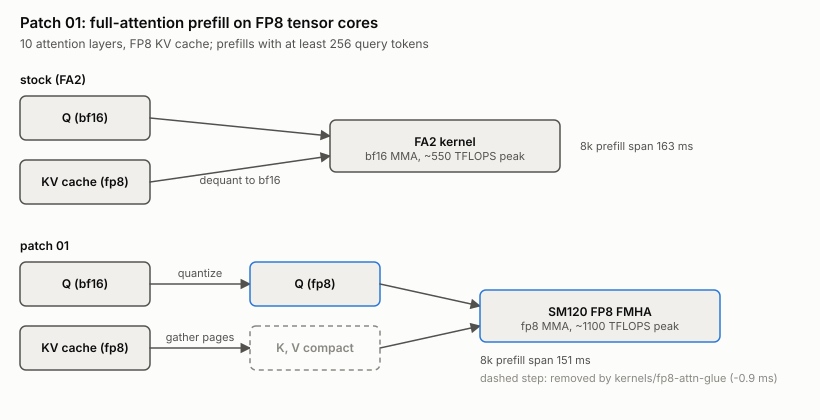
</picture>

<picture>
  <source media="(prefers-color-scheme: dark)" srcset="docs/img/mech-checkpoint-dark.svg">
  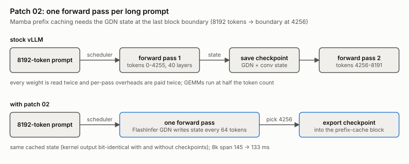
</picture>

### Kernel work (`kernels/`)

Each area has its own directory with a README, benchmarks and correctness tests. An independent agent re-runs
every claimed gain before it is integrated. Numbers below are from each area's README; "next" is the candidate
config that stacks the verified pieces on top of optimized.

<picture>
  <source media="(prefers-color-scheme: dark)" srcset="docs/img/kernel-gains-dark.svg">
  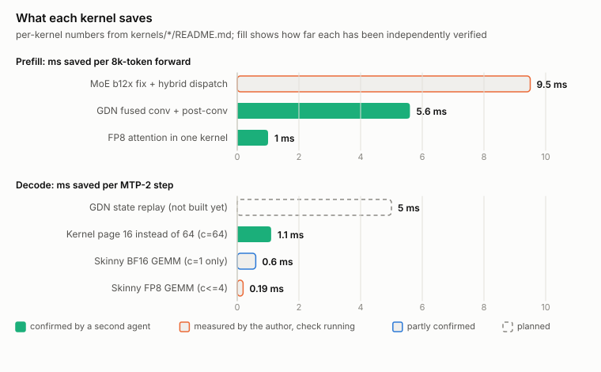
</picture>


| area | what | written in | result | status |
|---|---|---|---|---|
| [`fp8-attn-glue`](kernels/fp8-attn-glue) | FP8 FMHA prefill as one kernel: reads vLLM's packed K/V cache through strided TMA descriptors (no gather) and quantizes BF16 Q to e4m3 inside the kernel | CuTe DSL (FlashInfer kernel subclass) | bitwise identical output; −90 µs per attention call at 8k, −679 µs at 32k (~−1 ms per 8k forward, −7.5 ms per 32k) | patch 03, in next (8k span −11.7 ms with 05) |
| [`gdn-conv-fusion`](kernels/gdn-conv-fusion) | GDN prefill: causal conv1d + post-conv prep (q/k l2-norm, v, g, beta) in one pass, conv output never goes to HBM | Triton | 377 → 190 µs per layer at 8k, at the `copy_()` floor; ~−5.6 ms per 8k forward, −11 ms at 16k | patch 05, in next |
| [`moe-nvfp4`](kernels/moe-nvfp4) | found the b12x quality bug (block scales baked into e4m3 subnormals) and a scale-convention mismatch inside FlashInfer that zeroes 1-3 token outputs; fix + hybrid backend (b12x for ≥1024 tokens, CUTLASS below) | vLLM integration patch | MoE 28% faster at 8k tokens (631 vs 871 µs per layer); 8k TTFT −4.7%; NLL, needles, MTP acceptance unchanged | verification running |
| [`dense-fp8-gemm`](kernels/dense-fp8-gemm) | prefill: 13 CUTLASS configs and cuBLASLt swept, nothing beats vLLM (84% of the power-capped peak). Decode: new skinny-M FP8 tensor-core GEMV | CUDA C++ | prefill: no change shipped; decode: −1 to −3 µs per call, ~−0.19 ms per step at c ≤ 4 | tests queued |
| [`decode-roofline`](kernels/decode-roofline) | byte model of an MTP-2 decode step; skinny BF16 GEMM for the MoE router and GDN `in_proj_ba` (cuBLAS runs a 4-16 CTA kernel there) | Triton | c=1 ITL −9% (6.36 → 5.77 ms); no change at c ≥ 4 | verification running |
| [`cache-granularity`](kernels/cache-granularity) | finer prefix-match unit, so an agent turn re-prefills ~1,000 new tokens instead of ~2,150 | scheduler config | — | measuring |
| [`kv-offload`](kernels/kv-offload) | vLLM's native CPU offload for idle agent sessions; checked that it stores both attention KV and GDN state for this hybrid | connector config | — | measuring |
| [`session-cache`](kernels/session-cache) | keep each session's latest GDN state across turns (per-tenant reuse) | scheduler patch | — | measuring |
| kernel page (patch 04) | decouple the cache block (2176, needed by the checkpoint) from the attention kernel page (16 instead of 64) | 6-line patch | decode +4% at c=64, prefill unchanged or faster (`results/decode_ab/SUMMARY.md`) | patch 04, in next |

Not implemented yet, largest known decode lever: at c=64 the GDN fp32 state is written after each of the 3
speculative positions (10.6 ms of a 29 ms step). Replaying accepted tokens from one committed state instead is
bit-identical and would save about 5 ms per step (~18%) (`kernels/decode-roofline/README.md` §5).

**Status of each kernel** (second-agent checks are in `kernels/*/VERIFY.md`):

- `fp8-attn-glue`: confirmed, bitwise identical; the claimed gain was slightly overstated.
- `gdn-conv-fusion`: confirmed, bit-exact, speedup reproduces within about 2%.
- `decode-roofline` (skinny BF16): partly confirmed. About -0.6 ms per step at c=1, nothing at c >= 4, numerics match cuBLAS. Not integrated: its on/off flag is not part of vLLM's compile-cache key and the end-to-end quality evidence is only kernel-level.
- `moe-nvfp4`: partly confirmed. The diagnosis, the scale fix and the kernel speedup reproduce (9.0 ms per 8k prefill, 225 us per layer at 8k tokens). The end-to-end TTFT gain does not resolve from noise (-4.5 ms pooled, from +1 ms in the first A/B pair to -7 ms in the second), decode is unchanged, and the patch as shipped halves the KV cache (3.37M to 1.77M tokens). Not in next.
- `dense-fp8-gemm` (skinny FP8 decode GEMM): partly confirmed. Reproduces at kernel level (-223 us per c=1 step with cold weights; -78 us at c=16; nothing at c=64) and in situ (about -0.15 ms per step at c=1, -0.06 ms at c=4, because MTP-2 rounds the c=4 batch to M=18). The wall-clock gain sits inside the host noise.
- `deepgemm-sm120` (DeepGEMM `nv_dev`, native SM120 kernels, built and tested against our shapes): nothing to port. Dense FP8 at M <= 16: our skinny kernel is as fast or faster on all four layer shapes; at M = 8192 DeepGEMM is 6-8% slower than vLLM's CUTLASS. Grouped GEMM on the real 8k routing: DeepGEMM's MXF4 proxy (a different scale format from our NVFP4) is 20-24% slower than FlashInfer CUTLASS; its scheduler has no skew handling. Decode grouped GEMM at 3-192 tokens is 7-45% faster than our CUTLASS NVFP4, but no NVFP4 kernel was run, so the cause is unattributed (about 0.6 ms per step at most at c=1). The CUDA-graph crash of issue #444 does not reproduce on the tree that contains the fix (14 configs x 1000 replays x 48 routings, bitwise equal to eager).
- Ideas taken from DeepGEMM, measured in `kernels/pdl-swapab`: PDL is worth 1-2% at c=1 and nothing at c >= 16 (37% of kernel boundaries already overlap, FlashInfer enables PDL on SM120); swap-AB is already in FlashInfer's CUTLASS MoE decode tile, and its padding costs at most ~0.13 ms per step. b12x is 13-16% faster than CUTLASS at M=4-8 (0.25-0.32 ms per step) but needs a numerics check first.
- `cache-granularity`, `kv-offload`, `session-cache`: measurements or checks still queued for the GPU.

<picture>
  <source media="(prefers-color-scheme: dark)" srcset="docs/img/mech-gdn-fusion-dark.svg">
  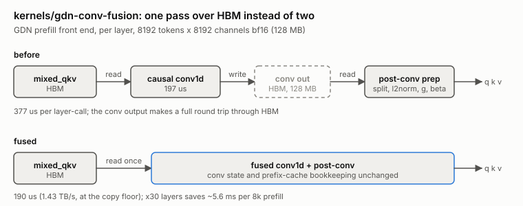
</picture>

<picture>
  <source media="(prefers-color-scheme: dark)" srcset="docs/img/mech-page-dark.svg">
  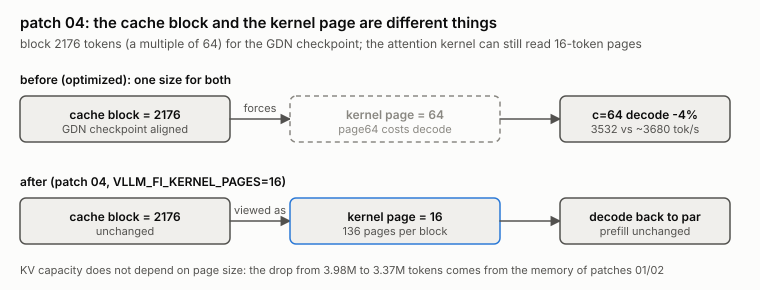
</picture>

<picture>
  <source media="(prefers-color-scheme: dark)" srcset="docs/img/mech-moe-dark.svg">
  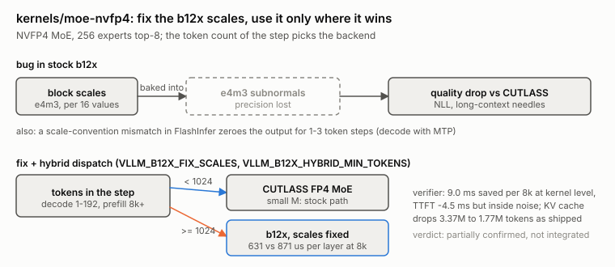
</picture>

<picture>
  <source media="(prefers-color-scheme: dark)" srcset="docs/img/mech-skinny-dark.svg">
  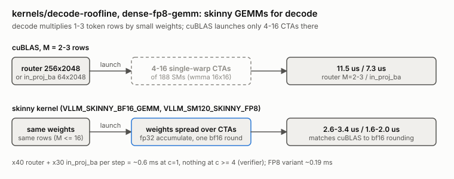
</picture>

<picture>
  <source media="(prefers-color-scheme: dark)" srcset="docs/img/mech-replay-dark.svg">
  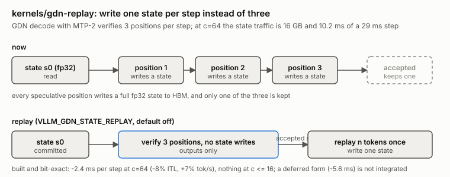
</picture>

## Quality

- Needle-in-a-haystack at 16k/32k tokens: 20/20 for every config.
- Prompt NLL (`eval/nll_rep.py`, `eval/nll_lic.py`, `results/quality/`): code documents are unchanged.
  On the repetitive licenses corpus, NLL rises by about +0.016 (30k chars) and +0.027 (60k chars) over 10
  repeats. Bisection: page64 and GDN in-place contribute 0. The checkpoint path adds +0.006/+0.013, which is
  near the ±0.008 restart-to-restart noise; its kernel output is bit-identical with and without checkpoints, and
  the difference is one chunk vs a two-chunk split. FP8 attention adds about +0.01 (rounding Q and P to e4m3;
  Q never clips, |Q| ≤ ~50).
- Prefix-cache correctness (`eval/ckpt_dist.py`): the first-token distribution after a checkpoint hit matches a
  cold run as closely as stock vLLM does (TV 0.12–0.13 for both). With the checkpoint export disabled the TV is
  0.79, so the test does detect a broken checkpoint.

If the small NLL cost of FP8 attention matters for your workload, run with `VLLM_SM120_FP8_PREFILL=0`. That still
keeps about 60% of the kernel-side gain.

## Layout

Figures are generated from `results/` by `python3 docs/make_figures.py` (light and dark SVG).

```
patches/vllm-v0.32.0/   patches 01-05 (optimized = 01, 02; next = 01-05) and rejected b12x MoE patches
scripts/                serve.sh (CONFIG=production|tuned|optimized|next), build_patched.sh, nsys_capture.sh
bench/                  throughput_sweep.sh, bench_prefill.sh, bench_decode.sh, nsys analysis, compare_sweeps.py
eval/                   NLL, needle, prefix-cache checkpoint and quality probes
microbench/             tensor-core issue rate (mma_rate.cu), GEMM, attention and MoE microbenchmarks
kernels/                per-area kernel work (one directory per area, each with its own README)
results/                raw numbers for everything above
docs/upstream-issues.md bugs and limitations found in vLLM / FlashInfer, for reporting upstream
```

## Reproduce

```sh
scripts/build_patched.sh                 # pristine files from the image + patches -> build/
CONFIG=next scripts/serve.sh             # or production / tuned / optimized; NSYS=1 to profile
bench/throughput_sweep.sh results/throughput/optimized.tsv
python3 eval/nll_lic.py out.json 10
```

`serve.sh` expects the model in `/opt/intramind/hf-cache` (override with `HF_CACHE`) and runs as the user in the
docker group.

To apply this to an existing deployment: add the tuned flags, then bind-mount `build/vllm/...` over the two vLLM
files and set the three env flags (see `scripts/serve.sh`).
