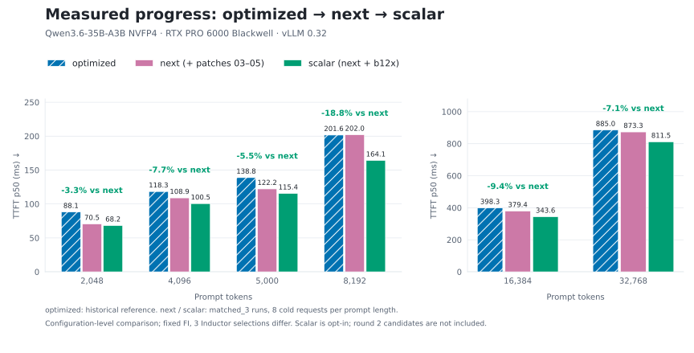

# sm120-vllm-kernels

Kernel and serving optimizations for **unsloth/Qwen3.6-35B-A3B-NVFP4-Fast** on **vLLM v0.32.0** with one
**RTX PRO 6000 Blackwell** (SM120, 188 SMs, 600 W).

The model is a hybrid: 30 Gated DeltaNet (linear attention) layers, 10 full-attention layers
(16 Q / 2 KV heads, head_dim 256, FP8 KV cache) and a 256-expert top-8 MoE in every layer. MoE weights are NVFP4,
and the attention/GDN projections are FP8. MTP-2 speculative decoding is on.

## Progress: optimized → next → scalar

Updated **2026-10-28**. This chart shows the measured configurations together;
`optimized` is the historical reference, while `next` and `scalar` use the newer
matched serving pair. All bars measure cold single-request TTFT in milliseconds.

<picture>
  <source media="(prefers-color-scheme: dark)" srcset="docs/img/progress-prefill-dark.svg">
  
</picture>

| configuration | stack | status |
|---|---|---|
| `optimized` | scheduler tuning + patches 01–02 | historical reference |
| `next` | optimized + patches 03–05 | recommended default |
| `scalar` | next + scale fixes, shared b12x workspace and scalar-scale dispatch | measured opt-in stack; 17 serving tasks and final agentic pair completed |

Against `next_matched_3`, scalar TTFT is **202.0 → 164.1 ms at 8k**,
**379.4 → 343.6 ms at 16k**, and **873.3 → 811.5 ms at 32k**.
Mixed-workload throughput changes range from −1.4% to +5.2%; the final agentic
effects are modest and mixed. Scalar retains documented NLL caveats and remains
opt-in. FlashInfer tactics are fixed in the serving pair; three Inductor
selections differ, so the chart compares complete configurations.

[Progress and round 2 status](docs/PROGRESS.md) ·
[Serving comparison](results/qwen_sequential/scalar_vs_next_matched_3.serving.md) ·
[Final agentic results](results/qwen_sequential/final_agentic_analysis.md) ·
[Chart data](docs/img/progress-prefill-data.json) · [Regenerate chart](docs/plot_progress.py)

[External kernel review](docs/EXTERNAL_KERNEL_REVIEW.md): comparison with the newer
B12x implementation, DP4A expert reuse, CUTLASS policies, shared-expert fusion,
and a same-checkpoint Marlin control. These are ongoing experiments, not added
to the measured gains above.

## Recommended configuration

**`CONFIG=next`**: the tuned scheduler settings plus patches 01-05 (all env-gated, off by default).

```bash
scripts/build_patched.sh        # builds build/ from patches/vllm-v0.32.0/*.patch
CONFIG=next scripts/serve.sh --enable-auto-tool-choice --tool-call-parser qwen3_coder --reasoning-parser qwen3 \
    --gpu-memory-utilization 0.65
```

| in `next` | flag | measured |
|---|---|---|
| CUDA graphs to 16k tokens, `--max-num-batched-tokens 16384` | (settings) | 8k prefill 369 → 163 ms |
| FP8 attention prefill (01) | `VLLM_SM120_FP8_PREFILL=1` | 163 → 151 ms |
| GDN in-place output + in-forward checkpoint (02) | `VLLM_GDN_INTERNAL_CKPT=1` | → 133 ms |
| FP8 attention in one kernel (03) | `VLLM_SM120_FP8_PREFILL_NOGLUE=1` | bitwise identical |
| 2176-token cache block, 16-token kernel pages (04) | `VLLM_FI_KERNEL_PAGES=16`, `--block-size 2176` | c=64 decode loss of page 64 recovered (~4%) |
| fused GDN conv + post-conv (05) | `VLLM_GDN_FUSED_CONV=1` | -190 us per layer at 8k, bit-exact |

Result: 8k prefill GPU span 369 → 125 ms (-66%), median 8k TTFT 190 ms (tuned 230). Mixed-load throughput is close to
`optimized` (+7% on mixed-len, +3% on chat, the rest inside noise); the gain is prefill latency.

Optional, depending on the deployment:

| option | when | note |
|---|---|---|
| `--kv-offloading-size N` (GiB of pinned host RAM) | many sessions idle between turns | the tier must hold the whole live working set: 13.3 KB per token; too small is useless |
| `VLLM_GDN_STATE_REPLAY=1` | about 48 or more concurrent decodes | c=64 ITL -8%, nothing at c <= 16; single-agent check only |
| `--prefix-match-unit 16` | long single-tenant sessions | verified on `production`, not yet on `next` |

Not included in default `next`: MoE b12x (the opt-in scalar composition completes final agentic with modest, mixed effects), skinny BF16/FP8 GEMMs (0.6 and
0.15 ms at c=1), fused router, session state cache, PDL, DeepGEMM. Reasons and numbers are in "Kernel work" below.

GPU memory of `next`, measured with `nvidia-smi` on the 95.6 GiB card (a 24k-token prompt adds nothing on top):

| `--gpu-memory-utilization` | used | KV tokens | concurrent 131k sessions |
|---:|---:|---:|---:|
| 0.35 | 35.4 GiB | 284,564 | 2.2 |
| 0.50 | 49.6 GiB | 1,360,734 | 10.4 |
| 0.65 | 63.9 GiB | 2,436,904 | 18.6 |
| 0.78 | ~75 GiB | ~3.2M | 24.5 |

Weights take 21.2 GiB and the CUDA graphs 5-6 GiB; the rest is KV. Lower the setting to share the GPU with other models.

Serving notes from a tool-calling test on `next`: vLLM 0.32 returns the reasoning text in the **`reasoning`** field
(`reasoning_content` is only accepted on input), so clients should read both. With the hybrid cache, a prompt shorter
than one 2176-token block gets no prefix-cache hit. Thinking costs reasoning tokens even for a simple tool choice
(231 in one test), and re-sending earlier reasoning in the history made one second turn run to the token limit (n = 1).

Not done yet: a soak test (~30 min of mixed load) and restoring KV capacity with
`--gpu-memory-utilization 0.8424` at the default setting. The full final agentic
pair on `next` and scalar is [complete](results/qwen_sequential/final_agentic_analysis.md).

## Results

<picture>
  <source media="(prefers-color-scheme: dark)" srcset="docs/img/prefill-span-dark.svg">
  
</picture>

8k-token single-request prefill, GPU span from nsys (`results/nsys/`):

| config | ms / request | vs production |
|---|---:|---:|
| production (vLLM defaults) | 369 | |
| tuned (config only) | 163 | −56% |
| optimized (tuned + patches 01, 02) | 133 | −64% |
| next (optimized + patches 03, 04, 05) | 125 | −66% |

`next` is measured against optimized in the same session (137 → 125 ms at 8k, 574 → 551 ms at 32k;
`results/next/SUMMARY.md`). The newer individual-task comparison below evaluates shared b12x against `next`;
the historical tables still compare production, tuned and optimized. The newer
[final agentic pair](results/qwen_sequential/final_agentic_analysis.md) compares `next` with the selected scalar stack.

Current Qwen prefill experiment: [shared b12x workspace](kernels/moe-nvfp4/SHARED_WORKSPACE.md)
retains KV capacity. Its exact-alpha variant completed [all 17 serving tasks](results/qwen_sequential/exact_vs_next_tasks_1.serving.md)
at GPU utilization 0.78. Against the **earlier** `next_tasks_1` full matrix,
8k/16k/32k TTFT is 191.6→187.3 / 384.5→363.3 / 866.3→809.3 ms
(−2.3%/−5.5%/−6.6%); 2k regresses 11.9%. Seven workload throughputs rise
0.5–9.0%, but TTFT and sampled decode results are mixed. The earlier shared
run's 12.7–14.3% long-prefill gain is not reproduced at that size.
The [CPU audit](results/qwen_sequential/prefill_runtime_cpu_audit.md) found
43/132 FlashInfer tactics and 4/13 selected Inductor configs differ between
shared and exact despite matching server config and generated code.

A fresh [explicit-greedy decode diagnostic](results/qwen_sequential/exact_vs_next_greedy.md)
against `next_diagnostic_1` is near neutral: output rates change
−0.51%/+1.41%/+0.78%/−0.73% at c=1/4/16/64. Five cold NLL repeats for ten
prompts ([50 calls per backend](results/qwen_sequential/exact_vs_next_repeated_nll.txt))
do not reproduce the earlier large deterioration: mean deltas range
−0.008684 to +0.003118, each smaller than the observed within-backend repeat
spread. Positive deltas remain; these ranges are not confidence bounds or
quality equivalence. The diagnostic baseline had no preceding full matrix,
so prior history differs. Neither speed nor quality changes are attributed
to the two load-time alpha expressions.

`shared_exact/` is the experimental parent for incremental stack tests.
b12x remains opt-in outside `next`; the scalar composition completes the final
agentic comparison with modest, mixed effects. The [earlier shared results and quality flags](results/qwen_sequential/shared_vs_next_tasks_1.analysis.md)
retain their original scope.

The fresh [scalar versus exact parent pair](results/qwen_sequential/scalar_vs_exact_matched_3.serving.md)
completes all 17 tasks with identical 132-entry FlashInfer tables at startup and
shutdown. Scalar 4k/8k/16k TTFT is 107.51→100.54  / 185.15→164.08  / 384.57→343.63 ms
(-6.5%/-11.4%/-10.6%). Seven task throughputs change -5.3% to +1.5%;
[greedy decode](results/qwen_sequential/scalar_vs_exact_matched_3.greedy.md) changes
-1.91% to+4.63%. Four of 13 Inductor tuning records differ. The [compiled-artifact audit](results/qwen_sequential/scalar_inductor_runtime_cpu_audit.md)
finds matching candidate sets but leaves some final selections unresolved; neither
a compiler cause nor isolated scalar attribution is established. Both pass 20/20 needles, but py_email-30000 NLL worsens
0.794235→0.802070 across three cold repeats with nonoverlapping observed ranges
([details](kernels/moe-nvfp4/SCALAR_DISPATCH.md)). Scalar completes final
agentic evaluation with this quality flag retained; neither replay nor the
limited live smoke is a broad model-quality pass. Default `next` is unchanged.

The fresh fixed-FlashInfer `next_matched_3` reference also completes the same
17 tasks, four greedy cases, 30 cold NLL calls and both 132-entry boundary gates.
The complete measured configurations have these cold-prefill TTFT medians:

| input tokens | next ms | shared_exact ms | scalar ms |
|---:|---:|---:|---:|
| 2048 | 70.53 | 68.52 | 68.19 |
| 4096 | 108.95 | 107.51 | 100.54 |
| 5000 | 122.18 | 120.86 | 115.44 |
| 8192 | 201.98 | 185.15 | 164.08 |
| 16384 | 379.35 | 384.57 | 343.63 |
| 32768 | 873.31 | 838.71 | 811.50 |

Against this `next`, [scalar workload throughputs](results/qwen_sequential/scalar_vs_next_matched_3.serving.md)
change -1.4% to +5.2%, and greedy decode rates -3.70% to +3.67%.
All three pass 20/20 needles. Scalar py_email-30000 NLL is +0.002717 versus
`next`, with overlapping observed ranges; the larger scalar-versus-exact flag
above remains recorded. These are single-run configuration comparisons and
small diagnostic corpora, not quality equivalence or isolated patch attribution.
At GPU budget 0.78, logged KV availability is 44.61 / 45.50 / 45.50 GiB and final
CUDA graph pool 4.90 / 3.45 / 3.45 GiB for next / exact / scalar respectively.
The [completed scalar + GDN comparison](kernels/gdn-norm-fp8/results/COMPOSED_SERVING.md)
also passes all 17 tasks, four greedy cases, 30 cold NLL calls, 20/20 needles
and both fixed-FlashInfer boundary gates. Against scalar, 32k TTFT falls
811.50→750.03 ms (-7.6%) and long-doc throughput rises 9.1%, but 8k TTFT
rises 164.08→176.22 ms (+7.4%) and greedy c=64 throughput falls 8.71%.
Against `next`, the stack's 8k/16k/32k TTFT falls 12.8%/8.1%/14.1%, while
greedy c=64 falls 8.17%. The licenses-30000 mean NLL is +0.010715 versus
`next`, with nonoverlapping observed three-repeat ranges; this remains a
historical quality flag. The completed reversed-order
GDN→scalar repeat changes the 8k result to -7.31% and the 32k gain to -1.98%,
but greedy c=4/c=64 still lose 4.18%/4.04% (c=16 loses 7.70%). Its five-round
licenses-30000 delta versus scalar is only +0.000125, with overlapping ranges;
this does not establish quality equivalence or retest the earlier `next` pair.

The [selected final stack](results/qwen_sequential/final_stack_selection.md)
is `next` patches 01–05 plus MoE patches 03–06 (`scalar`), keeping GDN norm/FP8
fusion opt-in and unselected for this configuration. This choice retains the
measured scalar prefill gains and avoids the repeated incremental c=4/c=64
losses. It is scoped to this Qwen/SM120 workload, not a general rejection of
GDN fusion. The [final agentic pair](results/qwen_sequential/final_agentic_analysis.md)
completes all eight shapes: 5,772 verified turns and 987,945 output tokens per
configuration. Short c=1/4/8/16/32 output rates change
+3.92%/-3.60%/+2.45%/+1.95%/+2.18%; long c=1/8/32 changes
+0.34%/+0.92%/+2.51%. Long c=32 TTFT p50 falls 866.08→816.42 ms (-5.73%),
but long c=8 p90 rises 698.23→775.53 ms and short c=4 wall time rises 3.73%.
These are modest, mixed observations from one sequential pair, not a robust
general speedup. The separate live smoke finishes only 1/8 tasks on either
side and uses canned tests; it does not establish coding quality. Scalar
remains opt-in, default `next` stays unchanged, and the earlier NLL flags remain.
Agentic was measured only for the selected complete stack.

The [experimental patch package](kernels/gdn-norm-fp8/PATCH_COMPOSITION.md)
reproduces all six measured scalar/GDN runtime files byte-for-byte in either
application order, after their documented prerequisites. This establishes source
composition, not speed or quality. The [private GDN state probe](kernels/gdn-norm-fp8/results/STATE_PROBE_GPU.md)
passes pure long prefill, mixed prefill/MTP decode and pure decode on layer 18:
six original/padded variants match FP8, scales and private convolution/recurrent
state bytes. It does not cover checkpoint-bearing metadata or every graph/state
allocation pattern. The completed serving pair above measures the composed
configuration; the source and scoped state proofs alone do not establish its
model quality or explain its performance changes.

<picture>
  <source media="(prefers-color-scheme: dark)" srcset="docs/img/throughput-dark.svg">
  
</picture>

Serving throughput, total tok/s (`results/throughput/COMPARISON.md`, one run per cell):

| scenario | in / out / concurrency | production | tuned | optimized |
|---|---|---:|---:|---:|
| long-doc | 32768 / 128 / 2 | 23,357 | +11% | **+32%** |
| prefill-heavy | 8192 / 64 / 8 | 27,038 | +44% | **+51%** |
| rag | 4096 / 256 / 16 | 16,916 | +36% | **+39%** |
| shared-prefix | 4096 shared + 1024 / 256 / 16 | 16,792 | +44% | **+59%** |
| mixed-len | 410–7782 / 51–973 / 32 | 13,213 | +38% | **+39%** |
| chat | 1024 / 512 / 32 | 5,552 | **+48%** | +43% |
| decode-heavy | 128 / 1024 / 64 | 4,385 | **+9%** | +3% |

<picture>
  <source media="(prefers-color-scheme: dark)" srcset="docs/img/ttft-dark.svg">
  
</picture>

Single-request median TTFT (`results/prefill/`): 8k 230 → 202 → 190 ms, 32k 1100 → 885 → 856 ms
(tuned → optimized → next). Decode at c=64 is unchanged by patches 01/02/03/05; the 64-token kernel page of
optimized costs ~4% at c=64, which patch 04 removes (`results/decode_ab/SUMMARY.md`).

### Agentic workloads

The historical figures below compare production, tuned and optimized. The newer
[`next` versus scalar result](results/qwen_sequential/final_agentic_analysis.md)
completes all eight short/long replay shapes with modest, mixed effects.

Multi-turn tool-calling sessions (list_dir / read_file / grep / write_file / run_tests) were recorded live, then
replayed with the same recorded prompt tokens and requested output lengths on each config; generated text may differ
(`bench/agentic_bench.py`, `results/agentic/SUMMARY.md`). There are two sets: short coding sessions
(10-30k tokens) and whole-package reviews that grow each session to ~126k tokens.

<picture>
  <source media="(prefers-color-scheme: dark)" srcset="docs/img/agentic-long-ttft-dark.svg">
  
</picture>

<picture>
  <source media="(prefers-color-scheme: dark)" srcset="docs/img/agentic-short-throughput-dark.svg">
  
</picture>

| | production | tuned | optimized |
|---|---:|---:|---:|
| long sessions, 1 agent, TTFT p50 / p90 | 433 / 624 ms | 415 / 614 ms | **279 / 373 ms** |
| long sessions, 32 agents, TTFT p50 / p90 | 1584 / 3785 ms | 1498 / 3266 ms | **997 / 1992 ms** |
| long sessions, 32 agents, turns/s | 2.32 | 2.36 | **3.42 (+47%)** |
| short sessions, 32 agents, turns/s | 4.37 | 5.44 | **6.03 (+38%)** |

At long context, per-turn time is dominated by attention over the cached prefix. The config change barely helps
there; FP8 attention (patch 01) is what cuts it by a third.

#### Agentic caching

Each turn's prompt is the previous prompt plus the model's output and a tool result. Attention KV can be reused
token by token, but the GDN recurrent state can only resume where it was saved, and stock vLLM saves it every
2128 tokens. So every turn recomputes the tail since the last boundary: on the long sessions ~4,760 tokens are
prefilled per turn when ~1,740 are new.

<picture>
  <source media="(prefers-color-scheme: dark)" srcset="docs/img/mech-agentic-cache-dark.svg">
  
</picture>

Three options were measured by their authors (A/B on one server with the same turns) and then re-run by a second
agent (`kernels/*/VERIFY.md`). All three verdicts are "partially confirmed": the mechanism and correctness hold,
but each has a cost the author's report missed.

<picture>
  <source media="(prefers-color-scheme: dark)" srcset="docs/img/agentic-cache-dark.svg">
  
</picture>

| option | what it does | measured gain | cost the verification found |
|---|---|---|---|
| `--prefix-match-unit 16` (vLLM flag, no patch) | GDN state saved every 16 tokens, so a hit lands inside a block | tokens prefilled per later turn 4,759 → 1,765; 1 agent: TTFT p50 488 → 343 ms, wall 184 → 149 s; 8 agents: wall 262 → 173 s (TTFT did not reproduce: 964 → 1,002 ms) | 3 extra pool blocks per idle session, so fewer idle sessions stay cached (-13% at 56 sessions of 90k; 48 sessions cross the pool limit and thrash, 14.5x slower). 32 agents on ~100k contexts: wall -18% but TTFT p50 +32%. Each hit splits the turn's prefill into 1-3 chunks (+35-65 ms of TTFT at 1 agent); the whole prompt is re-hashed per turn (4.6 → 23 ms at 126k). Restored state is bit-identical to the producer's. |
| session state cache (`VLLM_SESSION_STATE_CACHE=1`, patch) | keeps each session's exact end-of-turn state | on top of unit 16 only ~7% TTFT at 1 agent, nothing at 8; unit 16 already gets 90-95% of the token savings | with the default limits 250 idle sessions pinned 1,024 of 2,200 blocks and evicted the active agents' history (prefill per turn 2,592 → 47,661, TTFT p50 1.6 → 69 s). MTP acceptance lower in 5 of 5 pairs. V2 runner only. Not recommended. |
| CPU offload of idle sessions (`--kv-offloading-size 96`, vLLM native, no patch) | stores attention KV and GDN state in host RAM | 64 idle sessions of 60-126k tokens: 71% → 0.6% of later turns lose their prefix, TTFT p50 198 s → 2.2 s (verified 175 s → 2.9 s), 31.6 → 182 tok/s; restoring 100k tokens takes 21-34 ms over PCIe, TTFT +15 ms vs a GPU hit | the tier must hold the whole live working set: 13.3 KB per token (96 GiB ≈ 7.7M tokens ≈ 70 sessions of 110k); 12 GiB gave zero hits, 64 GiB at 1.45x over capacity collapsed like no offload. Branching or edited histories get no reuse. 103 GB of pinned /dev/shm and +105 s startup. LMCache + MTP returns wrong state: do not combine. |

What this means for deployment: turn on `--prefix-match-unit 16` for long single-tenant sessions, size the offload
tier to the live working set when many sessions idle between turns, and skip the session state cache.
Every hit, GPU or CPU, still ends one 2,128-token block early because of vLLM's MTP checkpoint rule.

KV cache capacity drops with the larger CUDA graphs and the 64-token block: 3.98M tokens (production),
3.54M (tuned), 3.37M (optimized), that is 30, 27 and 26 concurrent 131k sessions. At 32 long sessions the
optimized config still wins and the prefix hit rate stays at 94%.

## What changed

**tuned** (no code change): `--max-num-batched-tokens 16384` and CUDA graphs captured up to 16384 tokens
(`scripts/cudagraph_sizes.txt`). With vLLM's default sizes an 8k prefill runs eagerly, and the GPU is busy only
40% of the time.

<picture>
  <source media="(prefers-color-scheme: dark)" srcset="docs/img/mech-cuda-graphs-dark.svg">
  
</picture>

**optimized** adds two patches (`patches/vllm-v0.32.0/`), each gated by env flags that default to off:

| flag | patch | effect |
|---|---|---|
| `VLLM_SM120_FP8_PREFILL=1` | 01 | Full-attention prefill (query ≥ 256 tokens) runs FlashInfer's SM120 FP8 FMHA (FP8 Q/K/V on the tensor cores) instead of FA2 with BF16 Q. Spec-decode verify steps keep the BF16 kernel. |
| `VLLM_FI_KERNEL_PAGE64=1` | 01 | 64-token kernel page, so the hybrid block size is a multiple of 64 (needed by the next flag). |
| `VLLM_GDN_INTERNAL_CKPT=1` | 02 | GDN prefill exports the mid-prompt Mamba prefix-cache checkpoint from inside the forward pass (FlashInfer `state_checkpoints`). Without it the scheduler splits every long prompt into two forward passes (8192 → 4256 + 3936). |
| (always, with 02) | 02 | FlashInfer GDN writes its output in place and takes exp(g) from the post-conv kernel, which saves a full-size copy per layer. |

8k span breakdown: 163 (tuned) → 151 (FP8 attention) → 145.5 (GDN in place) → 133 ms (internal checkpoint).

**next** adds three more patches, also env-gated (`CONFIG=next`, after `scripts/build_patched.sh`):

| flag | patch | effect |
|---|---|---|
| `VLLM_SM120_FP8_PREFILL_NOGLUE=1` | 03 | The FP8 FMHA reads K/V straight from vLLM's packed cache through strided TMA descriptors and quantizes Q inside the kernel: 4-5 launches per attention call become 1, output bitwise identical. |
| `VLLM_FI_KERNEL_PAGES=16`, `--block-size 2176` | 04 | Keeps the 64-aligned cache block that the checkpoint needs, but runs attention on 16-token pages. Removes the ~4% decode loss of the 64-token page. |
| `VLLM_GDN_FUSED_CONV=1` | 05 | GDN causal conv1d and post-conv prep in one Triton kernel; the 128 MB conv output never goes to HBM (377 → 190 µs per layer at 8k). |

<picture>
  <source media="(prefers-color-scheme: dark)" srcset="docs/img/mech-fp8-attention-dark.svg">
  
</picture>

<picture>
  <source media="(prefers-color-scheme: dark)" srcset="docs/img/mech-checkpoint-dark.svg">
  
</picture>

### Kernel work (`kernels/`)

Each area has its own directory with a README, benchmarks and correctness tests. An independent agent re-runs
every claimed gain before it is integrated. Numbers below are from each area's README; "next" is the candidate
config that stacks the verified pieces on top of optimized.

<picture>
  <source media="(prefers-color-scheme: dark)" srcset="docs/img/kernel-gains-dark.svg">
  
</picture>


| area | what | written in | result | status |
|---|---|---|---|---|
| [`fp8-attn-glue`](kernels/fp8-attn-glue) | FP8 FMHA prefill as one kernel: reads vLLM's packed K/V cache through strided TMA descriptors (no gather) and quantizes BF16 Q to e4m3 inside the kernel | CuTe DSL (FlashInfer kernel subclass) | bitwise identical output; −90 µs per attention call at 8k, −679 µs at 32k (~−1 ms per 8k forward, −7.5 ms per 32k) | patch 03, in next; confirmed by a second agent (gain slightly smaller than claimed) |
| [`gdn-conv-fusion`](kernels/gdn-conv-fusion) | GDN prefill: causal conv1d + post-conv prep (q/k l2-norm, v, g, beta) in one pass, conv output never goes to HBM | Triton | 377 → 190 µs per layer at 8k, at the `copy_()` floor; ~−5.6 ms per 8k forward, −11 ms at 16k | patch 05, in next; confirmed by a second agent |
| [`moe-nvfp4`](kernels/moe-nvfp4) | found the b12x quality bug (block scales baked into e4m3 subnormals) and a scale-convention mismatch inside FlashInfer that zeroes 1-3 token outputs; fix + hybrid backend (b12x for ≥1024 tokens, CUTLASS below) | vLLM integration patch | original kernel 28% faster at 8k; exact-alpha shared variant retains KV capacity, 8k/16k/32k TTFT −2.3%/−5.5%/−6.6% vs older next run, 2k +11.9%; greedy decode near neutral; repeated NLL is diagnostic only | experimental parent for stack tests, not in next |
| [`gdn-norm-fp8`](kernels/gdn-norm-fp8) | fuse gated RMSNorm + dynamic token FP8 for GDN prefill; preserve BF16 rounding and the CUTLASS projection | Triton/Gluon | layer 18 chain at 8k: 391→287 µs; full/focused serving vs scalar: 32k TTFT -7.6%/-2.0%, greedy c=64 rate -8.71%/-4.04% | default-off; unselected for the current final stack after mixed prefill and repeated c=4/c=64 losses |
| [`dense-fp8-gemm`](kernels/dense-fp8-gemm) | prefill: 13 CUTLASS configs and cuBLASLt swept, nothing beats vLLM (84% of the power-capped peak). Decode: new skinny-M FP8 tensor-core GEMV | CUDA C++ | prefill: no change shipped; decode: skinny kernel -223 us per step at c=1 on cold weights, in situ about -0.15 ms at c=1 and -0.06 ms at c=4 (MTP-2 pads c=4 to M=18) | partly confirmed, not in next |
| [`decode-roofline`](kernels/decode-roofline) | byte model of an MTP-2 decode step; skinny BF16 GEMM for the MoE router and GDN `in_proj_ba` (cuBLAS runs a 4-16 CTA kernel there) | Triton | skinny BF16: c=1 ITL -9% (6.36 → 5.77 ms) by the author, verifier -0.6 ms per step at c=1, nothing at c >= 4 | partly confirmed; flag not in the compile-cache key, not in next |
| [`cache-granularity`](kernels/cache-granularity) | finer prefix-match unit, so an agent turn re-prefills ~1,000 new tokens instead of ~2,150 | scheduler config | `--prefix-match-unit 16`: tokens prefilled per later turn 4,759 → 1,765, 1 agent TTFT p50 488 → 343 ms; costs in the Agentic caching section | partly confirmed; vLLM flag, no patch |
| [`kv-offload`](kernels/kv-offload) | vLLM's native CPU offload for idle agent sessions; checked that it stores both attention KV and GDN state for this hybrid | connector config | 64 idle sessions of 60-126k tokens: turns losing their prefix 71% → 0.6%, TTFT p50 198 s → 2.2 s; restoring 100k tokens takes 21-34 ms | confirmed with sizing caveats; vLLM native, no patch |
| [`session-cache`](kernels/session-cache) | keep each session's latest GDN state across turns (per-tenant reuse) | scheduler patch | only ~7% TTFT at 1 agent on top of `--prefix-match-unit 16`; default limits evict active histories (TTFT p50 1.6 → 69 s) | partly confirmed, not recommended |
| [`gdn-replay`](kernels/gdn-replay) | GDN decode with MTP-2: skip the three per-position fp32 state writes in verify, then replay only the accepted tokens into one slot | CUDA C++ | bit-exact (205 checks); c=64 ITL 28.6 → 26.2 ms (-8%), +7% tok/s, nothing at c <= 16 | `VLLM_GDN_STATE_REPLAY`, off by default, second-agent check not run |
| [`fused-router`](kernels/fused-router) | router GEMM + softmax + top-8 in one kernel | CUDA C++ (`mma.sync`) | -109 us per step at c=1, 60-77 us at c=2-4, nothing from c=8; top-8 equals the fp64 reference in every real row | not integrated, changes routing for ~3% of rows |
| [`pdl-swapab`](kernels/pdl-swapab) | PDL and swap-AB, ideas from DeepGEMM | historical synthetic microbenchmarks | historical PDL 1-2% is not a measured vLLM benefit; swap-AB already in FlashInfer | no kernel shipped |
| [`deepgemm-sm120`](kernels/deepgemm-sm120) | DeepGEMM `nv_dev` native SM120 kernels vs ours | benchmarks | nothing to port; issue #444 does not reproduce | study only |
| kernel page (patch 04) | decouple the cache block (2176, needed by the checkpoint) from the attention kernel page (16 instead of 64) | 6-line patch | decode +4% at c=64, prefill unchanged or faster (`results/decode_ab/SUMMARY.md`) | patch 04, in next |

The largest decode lever found, GDN state replay, is built (`kernels/gdn-replay`) and is off by default; it only pays at high concurrency (see the status list below).

**Status of each kernel** (second-agent checks are in `kernels/*/VERIFY.md`):

- `fp8-attn-glue`: confirmed, bitwise identical; the claimed gain was slightly overstated.
- `gdn-conv-fusion`: confirmed, bit-exact, speedup reproduces within about 2%.
- `decode-roofline` (skinny BF16): partly confirmed. About -0.6 ms per step at c=1, nothing at c >= 4, numerics match cuBLAS. Not integrated: its on/off flag is not part of vLLM's compile-cache key and the end-to-end quality evidence is only kernel-level.
- `moe-nvfp4`: the diagnosis, scale fix and kernel speedup reproduce. The original patch halves KV capacity; shared workspace removes that penalty. The exact-alpha variant completed all 17 tasks, near-neutral explicit-greedy decode and 50 cold NLL calls per backend. The earlier large NLL deterioration did not reproduce in those repeats, which do not establish quality equivalence. Prefill gains are smaller than the older shared pair; independent autotuning is a concrete confound. Exact is the experimental parent. Scalar now completes a controlled full pair with faster cold prefill, mixed task/decode rates and a retained NLL flag; four tuning records differ without proving four runtime choices differ. The final scalar-versus-next agentic pair completes with output-rate changes -3.60% to +3.92%, including a worse long c=8 TTFT p90; one pair establishes no robust/general gain. Quality flags remain. Not in default next.
- `gdn-norm-fp8`: exact standalone FP8/scales/projection checks and the scoped layer 18 private-state probe pass. All 30 layers activate in the compiled integration. The [composed full serving pair](kernels/gdn-norm-fp8/results/COMPOSED_SERVING.md) completes all tasks but trades faster 32k prefill and long-doc throughput for slower 8k prefill and greedy c=64 versus scalar. It passes 20/20 needles; cold NLL flags remain. The focused reverse-order pair repeats c=4/c=64 losses despite variable prefill benefits. The final agentic pair uses scalar without this additional fusion and is complete; GDN remains opt-in for further scoped work. Default-off, not in next.
- `dense-fp8-gemm` (skinny FP8 decode GEMM): partly confirmed. Reproduces at kernel level (-223 us per c=1 step with cold weights; -78 us at c=16; nothing at c=64) and in situ (about -0.15 ms per step at c=1, -0.06 ms at c=4, because MTP-2 rounds the c=4 batch to M=18). The wall-clock gain sits inside the host noise.
- `gdn-replay`: built by one agent, not yet re-run by a second. Same-step form: verify skips the state writes, one commit launch per KV-cache group replays the accepted tokens. Bit-exact against the stock kernel in all 30 layers (47,640+ row-layer-steps, 0 mismatches), MTP acceptance unchanged (0.596 and 0.599 off, 0.599 and 0.591 on), stress run with 37 aborts clean. End-to-end at c=64: ITL 28.61 → 26.23 ms (-8.3%), 3,599 → 3,859 tok/s (+7.2%); c=16 and c=32 neutral. Below 8 requests the stock path runs. Worth enabling only at about 48 or more concurrent decodes (`VLLM_GDN_STATE_REPLAY_MIN_REQS`). A first live run collapsed acceptance to 0.06 because the commit used the first KV-cache group's block table for all groups; fixed. Not checked: preemption, TP > 1. The patch is `kernels/gdn-replay/patch/04-gdn-state-replay.patch` (numbered 04 inside that directory; it is not in `patches/` yet).
- `fused-router` (router GEMM + softmax + top-8 in one kernel, from DeepGEMM's mega-gate idea): built, 173 correctness checks pass, no end-to-end run yet. Top-8 ids match vLLM's `topk_softmax` exactly on injected logits; on the real weights the top-8 set equals the fp64 reference in every row, while vLLM's cuBLAS path picks a different set in about 2.7% of rows at M >= 4. Per step it saves 109 us at c=1 (1.8% of a 6.0 ms step) on top of the skinny BF16 GEMM, 60-77 us at c=2-4, nothing at c >= 8 (microbenchmark x 42 calls per step, an assumption). Not integrated: needs the quality check because it changes routing for ~3% of rows.
- `deepgemm-sm120` (DeepGEMM `nv_dev`, native SM120 kernels, built and tested against our shapes): nothing to port. Dense FP8 at M <= 16: our skinny kernel is as fast or faster on all four layer shapes; at M = 8192 DeepGEMM is 6-8% slower than vLLM's CUTLASS. Grouped GEMM on the real 8k routing: DeepGEMM's MXF4 proxy (a different scale format from our NVFP4) is 20-24% slower than FlashInfer CUTLASS; its scheduler has no skew handling. Decode grouped GEMM at 3-192 tokens is 7-45% faster than our CUTLASS NVFP4, but no NVFP4 kernel was run, so the cause is unattributed (about 0.6 ms per step at most at c=1). The CUDA-graph crash of issue #444 does not reproduce on the tree that contains the fix (14 configs x 1000 replays x 48 routings, bitwise equal to eager).
- Historical `kernels/pdl-swapab` PDL numbers came from synthetic glue/skinny kernels; they do not establish an actual vLLM gain or its overlap fraction. Current controlled experiments are tracked in [Progress](docs/PROGRESS.md). Swap-AB is already in FlashInfer's CUTLASS MoE decode tile; its historical padding estimate is at most ~0.13 ms per step. Earlier b12x microbenchmarks were 13-16% faster than CUTLASS at M=4-8 (0.25-0.32 ms per step), with numerical validation still required for that path.
- `cache-granularity`, `kv-offload`, `session-cache`: all re-run by a second agent and partly or fully confirmed; the numbers and their costs are in "Agentic caching" above.

<picture>
  <source media="(prefers-color-scheme: dark)" srcset="docs/img/mech-gdn-fusion-dark.svg">
  
</picture>

<picture>
  <source media="(prefers-color-scheme: dark)" srcset="docs/img/mech-page-dark.svg">
  
</picture>

<picture>
  <source media="(prefers-color-scheme: dark)" srcset="docs/img/mech-moe-dark.svg">
  
</picture>

<picture>
  <source media="(prefers-color-scheme: dark)" srcset="docs/img/mech-skinny-dark.svg">
  
</picture>

<picture>
  <source media="(prefers-color-scheme: dark)" srcset="docs/img/mech-replay-dark.svg">
  
</picture>

## Quality

- Needle-in-a-haystack at 16k/32k tokens: 20/20 for every config.
- Prompt NLL (`eval/nll_rep.py`, `eval/nll_lic.py`, `results/quality/`): code documents are unchanged.
  On the repetitive licenses corpus, NLL rises by about +0.016 (30k chars) and +0.027 (60k chars) over 10
  repeats. Bisection: page64 and GDN in-place contribute 0. The checkpoint path adds +0.006/+0.013, which is
  near the ±0.008 restart-to-restart noise; its kernel output is bit-identical with and without checkpoints, and
  the difference is one chunk vs a two-chunk split. FP8 attention adds about +0.01 (rounding Q and P to e4m3;
  Q never clips, |Q| ≤ ~50).
- Prefix-cache correctness (`eval/ckpt_dist.py`): the first-token distribution after a checkpoint hit matches a
  cold run as closely as stock vLLM does (TV 0.12–0.13 for both). With the checkpoint export disabled the TV is
  0.79, so the test does detect a broken checkpoint.

If the small NLL cost of FP8 attention matters for your workload, run with `VLLM_SM120_FP8_PREFILL=0`. That still
keeps about 60% of the kernel-side gain.

## Layout

Figures are generated from `results/` by `python3 docs/make_figures.py` (light and dark SVG).

```
patches/vllm-v0.32.0/   patches 01-05 (optimized = 01, 02; next = 01-05) and rejected b12x MoE patches
scripts/                serve.sh (CONFIG=production|tuned|optimized|next), build_patched.sh, nsys_capture.sh
bench/                  throughput_sweep.sh, bench_prefill.sh, bench_decode.sh, nsys analysis, compare_sweeps.py
eval/                   NLL, needle, prefix-cache checkpoint and quality probes
microbench/             tensor-core issue rate (mma_rate.cu), GEMM, attention and MoE microbenchmarks
kernels/                per-area kernel work (one directory per area, each with its own README)
results/                raw numbers for everything above
docs/upstream-issues.md bugs and limitations found in vLLM / FlashInfer, for reporting upstream
```

## Reproduce

```sh
scripts/build_patched.sh                 # pristine files from the image + patches -> build/
CONFIG=next scripts/serve.sh             # or production / tuned / optimized; NSYS=1 to profile
bench/throughput_sweep.sh results/throughput/optimized.tsv
python3 eval/nll_lic.py out.json 10
```

`serve.sh` expects the model in `/opt/intramind/hf-cache` (override with `HF_CACHE`) and runs as the user in the
docker group.

To apply this to an existing deployment: add the tuned flags, then bind-mount `build/vllm/...` over the two vLLM
files and set the three env flags (see `scripts/serve.sh`).
